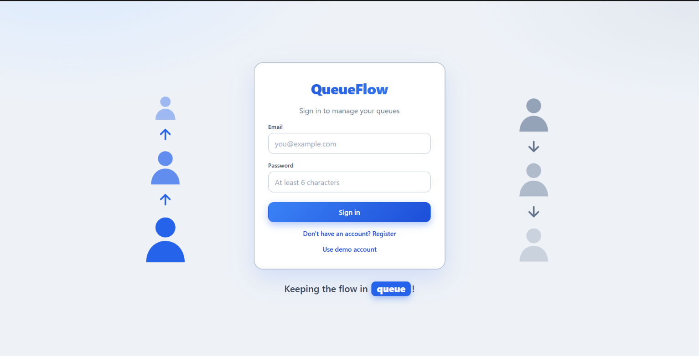
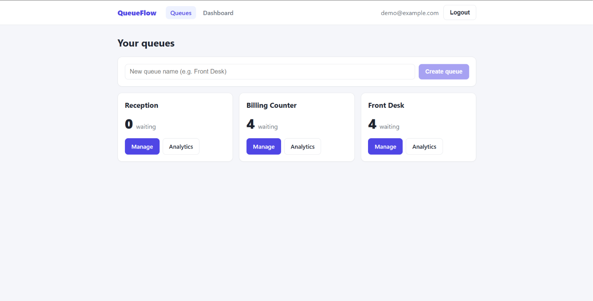
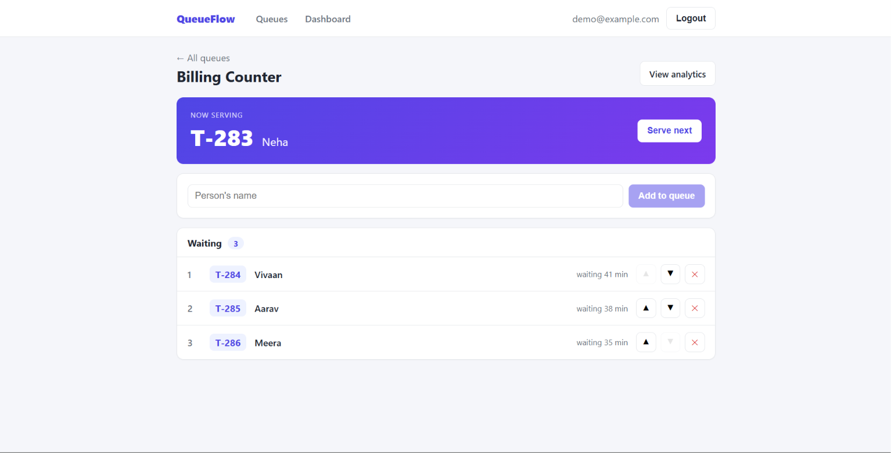
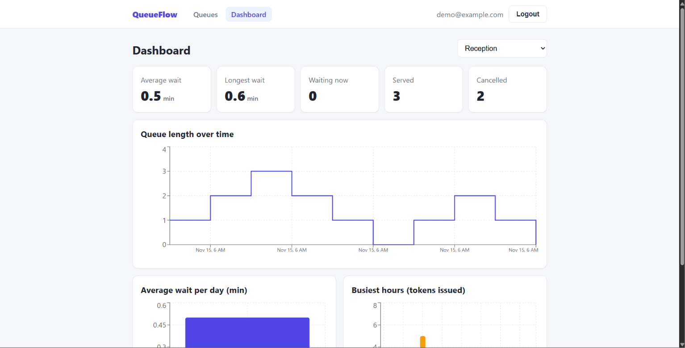

# QueueFlow: Queue Management App

A full-stack queue management application. A manager logs in, creates queues, adds people (each gets a token), reorders them, assigns the front token for service, cancels tokens, and views analytics on wait times and queue length.

**Live demo:** https://queueflow-uqvd.onrender.com
**Demo login:** `demo@example.com` / `demo1234`
**Source:** https://github.com/AutxstixDev/queue-manager

> Hosted on Render's free tier, so the first load after inactivity can take up to a minute.

## Screenshots





## Features
- Manager registration and login (JWT authentication)
- Create named queues
- Add a person to a queue, which creates a numbered token (T-001, T-002, ...)
- Waiting list shown in order, auto-refreshing every 5 seconds
- Move tokens up and down
- "Serve next" assigns the front token for service with one click
- Cancel a waiting token (with confirmation)
- Dashboard: average and longest wait, served and cancelled counts, queue length over time, average wait per day, busiest hours

## Tech stack
- **Frontend:** React (Vite), React Router, Axios, Recharts, plain CSS
- **Backend:** Node.js, Express
- **Database:** MongoDB (Mongoose), hosted on MongoDB Atlas
- **Auth:** JWT, bcrypt
- **Hosting:** Render (the Express server also serves the built React app)

## Run locally
Requires Node 20+ and a MongoDB connection string (a free MongoDB Atlas cluster works).

```bash
# 1. API
cd server
npm install
cp .env.example .env      # then fill in MONGO_URI and JWT_SECRET
npm run seed              # optional: loads demo data and the demo login
npm run dev               # http://localhost:5000

# 2. UI (in a second terminal)
cd client
npm install
npm run dev               # http://localhost:5173
```

`server/.env`:
```
PORT=5000
MONGO_URI=mongodb+srv://<user>:<password>@<cluster>.mongodb.net/queue-manager?retryWrites=true&w=majority
JWT_SECRET=<a long random string>
```

## API
| Method | Route | Purpose |
|---|---|---|
| POST | `/api/auth/register`, `/api/auth/login` | Register and log in |
| GET / POST | `/api/queues` | List / create queues |
| GET / POST | `/api/queues/:id/tokens` | Waiting list / add a person |
| POST | `/api/queues/:id/serve-next` | Serve the front token |
| GET | `/api/queues/:id/analytics` | Dashboard data |
| PATCH | `/api/tokens/:id/move` | Move a token up or down |
| PATCH | `/api/tokens/:id/cancel` | Cancel a waiting token |

All routes except auth require an `Authorization: Bearer <token>` header.

## Design decisions
- **Atomic token numbers:** an `$inc` on the queue's counter means two simultaneous adds never get the same number.
- **Reordering:** each waiting token has a `position`. Moving swaps positions with the neighbouring token, so nothing needs renumbering when tokens are served or cancelled.
- **Serve next** is a single `findOneAndUpdate`, so the same person can't be served twice.
- **Ownership checks:** every route verifies the queue or token belongs to the logged-in manager.
- **Analytics** use MongoDB aggregation pipelines. Queue length over time comes from an event log written on every add, serve and cancel.

## Assumptions
- Tokens are added by the manager; there is no customer-facing view.
- Wait time is the time from token creation to being assigned for service.
- A queue has one service point: serving the next token marks the previous one as completed.
